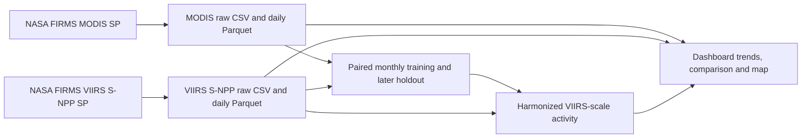

# SpectraFuse

See the [project reference](docs/PROJECT_REFERENCE.md) for the dataset inventory,
calibration methods, FRP experiments, API reference, and verification steps.

SpectraFuse builds a monthly active-fire calendar from NASA FIRMS MODIS Standard Processing and VIIRS Suomi-NPP Standard Processing. It preserves raw CSV, validates daily observations, writes Parquet, and estimates earlier MODIS activity on a VIIRS detection-count scale.

## Run on Windows

From PowerShell in the project folder:

```powershell
powershell -ExecutionPolicy Bypass -File .\backend\scripts\setup.ps1
.\.venv\Scripts\python.exe -m pytest -q
.\.venv\Scripts\python.exe -m backend.fire demo
powershell -ExecutionPolicy Bypass -File .\backend\scripts\run.ps1
```

Open http://127.0.0.1:8501. Select **Synthetic demo** to explore without credentials.

## Download NASA observations

Request a free [FIRMS MAP_KEY](https://firms.modaps.eosdis.nasa.gov/api/map_key/) and enter it as the value of FIRMS_MAP_KEY in the local .env file. Setup creates this file from .env.example if needed. Keep .env private. A process environment variable takes precedence.

```powershell
.\.venv\Scripts\python.exe -m backend.fire sync --area '79.5,5.8,82,10' --start 2018-01-01 --end 2023-12-31
```

The example uses a Sri Lanka bounding box. Dates are inclusive UTC dates. Use west,south,east,north or world. Start with a single full month to check access and download size. The [FIRMS Area API](https://firms.modaps.eosdis.nasa.gov/api/area) uses a transaction quota, and worldwide VIIRS requests can return many detections per day. Sync intersects the requested dates with each product's reported [availability](https://firms.modaps.eosdis.nasa.gov/api/data_availability/).

Each extent has its own folder under data, with its extent in area.txt. The raw/ and processed/ directories retain per-sensor, per-day CSV and Parquet. Re-run the same sync command to resume. A validated raw file is reused if its Parquet is missing. Completely processed days are skipped, including header-only days. To rebuild just the monthly exports:

```powershell
.\.venv\Scripts\python.exe -m backend.fire build --area '79.5,5.8,82,10'
```

Monthly exports live in harmonized/monthly.csv and harmonized/monthly.parquet. A month contributes a sensor total only when every calendar day has a processed partition. This measures request completeness. Coverage gaps within a successful NASA response can still affect detection counts. The downloader stops on an invalid response and retries transient HTTP failures with backoff.

## Method and validation

The pipeline validates coordinates, acquisition date and time, confidence, day/night flag, and finite nonnegative fire radiative power. It removes repeat records with the same sensor, satellite, coordinates, and timestamp. Native confidence is retained alongside descriptive classes. The one-degree grid columns store the lower-left coordinates of each detection's cell.

The model fits a single regional multiplier using the ratio of total VIIRS to total MODIS detections over the earlier paired months. It reserves the latest quarter of paired months, with at least one, to compare unscaled and scaled mean absolute error. Three training months and positive totals are required. The calendar uses observed VIIRS where available and scaled MODIS wherever MODIS has a complete total and VIIRS is unavailable. Blank cells indicate missing values. The dashboard can recalculate for a smaller extent, show monthly trends and seasonal departures, and export the selected period.

This regional baseline assumes a stable detection ratio through time. Sensor resolution, overpass frequency, cloud cover, and other differences can change that ratio. Detection counts describe observed hotspot activity. They do not measure burned area or unique wildfire events. Seasonal departures are descriptive and calculated from the median of at least two earlier values for the same calendar month.


## Sri Lanka pilot

Use the 2018–2023 sync command above, then open notebooks/sri-lanka-pilot.ipynb in a Jupyter-compatible editor with the project Python environment. The notebook compares raw monthly counts, later holdout errors, approximately 5 km shared grid cells, and anomalies against earlier same-month medians.

Shared grid-day matches represent co-occurrence over a UTC day. The grid has fixed angular spacing, so east–west width varies with latitude. A match can span distinct detections or overpasses. The notebook includes grid-days with at least one detection, and zero in either product means zero records in its downloaded daily partition. Satellite coverage is not observable from the hotspot CSV alone.

API requests fetch up to five consecutive dates at a time. The response is split into daily CSV files before checkpointing. The monthly error percentile describes past observed errors in the holdout and has no guaranteed interval coverage.

## Local API

Run the API in a second PowerShell window from the project folder:

```powershell
.\.venv\Scripts\python.exe -m uvicorn backend.main:app --host 127.0.0.1 --port 8000
```

Interactive API documentation is available at http://127.0.0.1:8000/docs. The fire endpoints use the existing Parquet store. Use region=sri-lanka for the pilot and region=demo for synthetic data. Hotspots accept a UTC day and product code. Area analysis accepts a bounding box within the downloaded extent.


After both products finish, generate the pilot CSVs and interactive chart:

```powershell
.\.venv\Scripts\python.exe backend/scripts/pilot_report.py
```

Use the reported output folder to find the monthly comparison chart, holdout metrics, and spatial validation. The spatial summary applies the region-wide multiplier to occupied grid-days as a diagnostic. The model is fitted on regional monthly totals.

To resume the full pilot with automatic pauses when FIRMS applies its transaction limit:

```powershell
powershell -ExecutionPolicy Bypass -File backend/scripts/sri-lanka-pilot.ps1
```

To export an interim report while downloading, add --partial to the pilot report command. The report is saved separately under pilot-partial.

## React web application

Install Python 3.13 and Node.js 22.12 or newer. From the project directory in PowerShell:

```powershell
powershell -ExecutionPolicy Bypass -File backend/scripts/setup.ps1
powershell -ExecutionPolicy Bypass -File backend/scripts/sri-lanka-pilot.ps1
powershell -ExecutionPolicy Bypass -File backend/scripts/run-web.ps1
```

Open http://127.0.0.1:8001 for the React dashboard and http://127.0.0.1:8001/docs for FastAPI. The launch script builds React and serves it with FastAPI on the same local address. The browser never needs the FIRMS key. The Leaflet basemap requires an internet connection.

Choose a year and sensor basis, then select a calendar cell to compare the raw sensor totals with harmonized activity and update the map. The anomaly view compares the selected series with prior observations for that calendar month. Monthly and detection CSVs are available from the dashboard. NOAA-20 is shown as a separate comparison product and does not enter the existing S-NPP calibration. Only complete NOAA-20 months enter the calendar.

### Data flow



The map starts with MODIS raw, VIIRS S-NPP raw, and Harmonized enabled. The legend toggles each layer and reports archive partition coverage. Select a calendar month or enter an inclusive UTC date range of up to 31 days and a bounding box within the downloaded region. Polygon selection further restricts the box. The map reads the local NASA archive via `/api/fire/map-layers`. Use the sync command to add dates or regions.

Raw map markers use recorded coordinates after validation and deduplication. A marker counts detections sharing that exact coordinate. Harmonized rectangles use an approximately 5 km angular grid and show activity inside the selected extent. For a fully covered date range they use observed S-NPP counts where available, or MODIS counts multiplied by the regional calibration factor when MODIS coverage is complete. Incomplete raw ranges show available detections and their partial status. A complete range with zero records is distinct from an unavailable range. The monthly holdout error describes regional monthly totals. The map has no validated uncertainty interval for a cell or custom date range.

Download additional NOAA-20 observations for the same extent:

```powershell
.\.venv\Scripts\python.exe -m backend.fire sync --source VIIRS_NOAA20_SP --area '79.5,5.8,82,10' --start 2018-04-01 --end 2023-12-31
```

The dashboard sees newly completed NOAA-20 partitions on refresh. Re-run the command after the FIRMS quota replenishes to resume from completed days. For development, run the FastAPI server on port 8000 and run npm ci followed by npm run dev from the frontend folder.

## Themes, regions, and deployment

Use the sun or moon button to switch themes. SpectraFuse initially follows the operating-system theme and remembers an explicit choice in the browser. The Region menu lists downloaded datasets. A geographic selection covers the extent shown by its dataset. Estimated months have MODIS provenance and an empirical error range derived from the monthly holdout.

Run the original Sri Lanka NOAA-20 holdout comparison with:

```powershell
.\.venv\Scripts\python.exe backend/scripts/noaa20_validation.py
```

Build a container and attach a populated local data directory:

```powershell
docker build -t firescope .
docker run --rm -p 127.0.0.1:8001:8001 --mount "type=bind,source=$((Resolve-Path data).Path),target=/app/data,readonly" firescope
```

For a hosted deployment, supply the same data directory as a persistent read-only volume and configure HTTPS on the hosting platform. The container only serves the processed data and does not require a FIRMS key. See SUBMISSION.md for the demonstration sequence.

Run the repeatable browser checks from frontend with npx playwright install chromium, followed by npx playwright test. Start the React and FastAPI application first and point FIRESCOPE_TEST_URL at its address. The suite uses the real Sri Lanka pilot.

To resume the complete Sri Lanka Standard Processing backfill, run backend/scripts/history.ps1. The product availability API bounds each request to the available historical dates. The Central Thailand comparison uses the 101,14,102,15 bounding box for 2023. Polygon drawing filters the selected month's map and detection download.

## Record the demo

With the web app running and the frontend dependencies installed, run node backend/scripts/record-demo.mjs from the project root. The script uses Microsoft Edge and produces data/demo-recording/firescope-demo.webm. Set FIRESCOPE_TEST_URL to the local server address if it differs from http://127.0.0.1:8003.

## Deploy to Vercel

From the repository root, run:

```powershell
python backend/scripts/stage_vercel.py
npx vercel@latest deploy --cwd .vercel-stage --archive=tgz
```

Sign in when prompted and select or create one Vercel project for .vercel-stage. That project serves the React dashboard at / and runs FastAPI at /api/fire on the same domain. Use the same linked project for the production deploy. Open the preview URL and check that the Sri Lanka dashboard and hotspot map load. Publish with `npx vercel@latest deploy --cwd .vercel-stage --archive=tgz --prod` when the preview is ready.

The staged deployment includes processed Parquet data and monthly summaries from the local dashboard regions. It requires an existing Sri Lanka dataset. It does not include the local .env or raw FIRMS downloads. The deployed dashboard serves a read-only snapshot and does not require a FIRMS key. To refresh it, sync the data locally, rerun the staging command, and redeploy. Deploy .vercel-stage with the CLI so Vercel receives the generated configuration and data archive.

The frontend production environment file is `frontend/.env.production`. Its relative API URL, `/api/fire`, sends requests to FastAPI on the same Vercel domain. Vite embeds these settings in the browser bundle, so keep credentials out of this file.

The backend reads the root `.env.production` when running locally. Copy `.env.production.example` to create it. Leave `FIRESCOPE_DATA_DIR` empty to use the bundled snapshot. On Vercel the bundled snapshot works with no environment variables. If a deployed runtime needs an override, set it in Vercel's environment settings.
